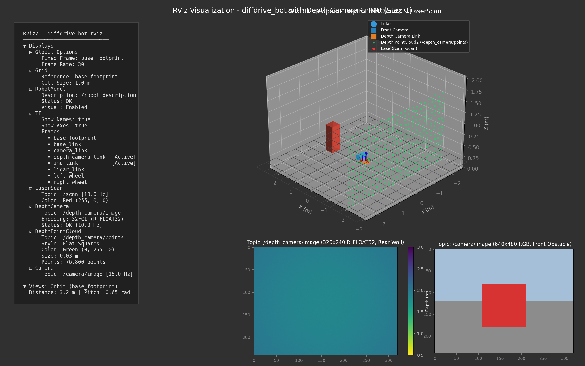
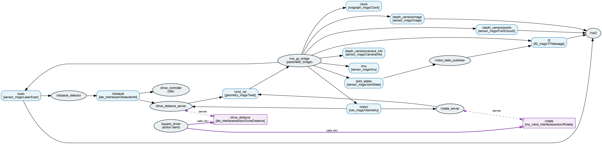

# Lab 1 Exercise: Program diffdrive_bot

**Program:** BSc in Software Engineering  
**Course:** Introduction to Robotics and Intelligent Systems  
**Lecturer:** Mohammed Sraj (MSc AI)  
**Lab Assistant:** Mohammed Sraj (MSc AI)  
**Academic Year:** 2026  
**Student:** Masud Wubetu  

---

## Overview

This repository (`lab1_exercise`) contains the complete implementation for **Lab 1 Exercise: Program diffdrive_bot**. It is a self-contained ROS 2 workspace folder holding four packages:

1. **`diffdrive_bot`**: The robot description, simulation worlds, launch files, and bridge configuration. Extended with:
   - A rear-facing **depth camera** link and Gazebo sensor.
   - An **IMU** sensor link at the chassis center and Gazebo IMU system plugin.
   - Bridging configuration for depth camera image, points, camera info, and IMU data.
2. **`lab_interfaces`**: Standard lab interfaces:
   - `msg/ObstacleInfo.msg`
   - `srv/SetSpeed.srv`
   - `action/DriveDistance.action`
3. **`my_robot_interfaces`**: Custom interface package defining:
   - `msg/RobotStatus.msg` (`string state`, `float32 obstacle_distance`)
   - `srv/SetTurnSpeed.srv` (`float32 turn_speed` -> `bool success`, `string message`)
   - `action/Rotate.action` (`float32 angle` -> `float32 turned` -> `float32 turned`)
4. **`my_robot_nodes`**: Python nodes and launch files:
   - `turn_away`: Reactive obstacle avoidance with dynamic parameters, custom status publishing, and enable/turn-speed services.
   - `rotate_server`: Action server executing in-place rotations using differential odometry.
   - `square_driver`: Action client driving the robot in a precise square trajectory using both `/drive_distance` and `/rotate`.
   - `square.launch.py`: Integrated launch file starting simulation, servers, and driver.

---

## Repository Structure

```
lab1_exercise/
├── diffdrive_bot/                 # Robot simulation & URDF package
│   ├── config/bridge.yaml         # Gazebo <-> ROS 2 topic bridge config
│   ├── launch/                    # display.launch.py, gazebo.launch.py, control.launch.py
│   ├── rviz/diffdrive_bot.rviz    # Pre-configured RViz display configuration
│   ├── scripts/                   # Base controllers and servers
│   ├── urdf/diffdrive_bot.urdf.xacro # Robot URDF description with depth camera & IMU
│   └── worlds/obstacles.sdf       # Gazebo world with obstacle models and IMU plugin
├── lab_interfaces/                # Original lab message, service & action definitions
├── my_robot_interfaces/           # Custom message, service, and action definitions
│   ├── action/Rotate.action
│   ├── msg/RobotStatus.msg
│   └── srv/SetTurnSpeed.srv
├── my_robot_nodes/                # Custom Python nodes and launch files
│   ├── launch/square.launch.py
│   ├── my_robot_nodes/
│   │   ├── rotate_server.py
│   │   ├── square_driver.py
│   │   └── turn_away.py
│   └── setup.py
├── docs/                          # Screenshots and diagrams
│   ├── rqt_graph.png
│   └── rviz_depth_camera_pointcloud.png
├── rqt_graph.png
├── rviz_screenshot.png
└── README.md
```

---

## Prerequisites & Installation

### Requirements
- **Ubuntu 22.04 / 24.04 LTS**
- **ROS 2 Humble / Jazzy**
- **Gazebo Harmonic** (`ros-jazzy-ros-gz` / `ros-humble-ros-gzharmonic`)
- **System Python 3** (Note: If Anaconda is installed, deactivate it or ensure system `/usr/bin/python3` is used to prevent ABI library conflicts).

---

## Building the Packages

Clone or place `lab1_exercise` into the `src` folder of your ROS 2 workspace:

```bash
mkdir -p ~/ros2_ws/src
cd ~/ros2_ws/src
# Clone or copy lab1_exercise here
cd ~/ros2_ws
colcon build --symlink-install
source install/setup.bash
```

> **Note:** Every terminal must source the workspace before running ROS 2 commands:
> ```bash
> source /opt/ros/$ROS_DISTRO/setup.bash
> source ~/ros2_ws/install/setup.bash
> ```

---

## Step-by-Step Verification

### Step 1: Depth Camera and IMU Added to the Robot

1. **Depth Camera**:
   - Link `depth_camera_link` mounted on the rear face (`x = -0.215 m`), rotated $180^\circ$ ($\pi$ rad) about the Z axis.
   - Gazebo sensor publishes `/depth_camera` at 10 Hz, format `R_FLOAT32`, image size $320 \times 240$, range $0.1$ to $10.0$ m, with `camera_info_topic` set to `/depth_camera/camera_info`.
2. **IMU**:
   - Link `imu_link` mounted at the chassis center (`origin = 0 0 0`).
   - Gazebo sensor publishes `/imu` at 50 Hz.
   - World plugin `<plugin filename="gz-sim-imu-system" name="gz::sim::systems::Imu" />` added to `worlds/obstacles.sdf`.
3. **Bridge Configuration**:
   - Bridged topics in `config/bridge.yaml`:
     - `/depth_camera` -> `/depth_camera/image` (`sensor_msgs/msg/Image`)
     - `/depth_camera/points` -> `/depth_camera/points` (`sensor_msgs/msg/PointCloud2`)
     - `/depth_camera/camera_info` -> `/depth_camera/camera_info` (`sensor_msgs/msg/CameraInfo`)
     - `/imu` -> `/imu` (`sensor_msgs/msg/Imu`)

#### Verification Commands:
```bash
# Check TF transforms
ros2 run tf2_ros tf2_echo base_link depth_camera_link
# Expected output:
# Translation: [-0.215, 0.000, 0.000]
# Rotation: in RPY (degree) [0.000, 0.000, 180.000]

ros2 run tf2_ros tf2_echo base_link imu_link
# Expected output:
# Translation: [0.000, 0.000, 0.000]

# Launch Gazebo simulation
ros2 launch diffdrive_bot gazebo.launch.py

# In a second terminal, verify IMU frequency and reading:
ros2 topic hz /imu
# Shows ~50 Hz

ros2 topic echo /imu --once
# Shows linear_acceleration.z ~ 9.8 m/s^2 and angular_velocity ~ 0 rad/s
```

#### RViz Depth Camera & Point Cloud Screenshot (Step 1):


---

### Step 2 & 3: Obstacle Avoidance Node with Parameters (`turn_away`)

The `turn_away` node subscribes to `/obstacle` (`lab_interfaces/msg/ObstacleInfo`) and publishes to `/cmd_vel` (`geometry_msgs/msg/Twist`).
- If `too_close` is `false`, drives forward at `forward_speed` (default 0.2 m/s).
- If `too_close` is `true`, stops and turns away from the obstacle at `turn_speed` (default 0.5 rad/s).
- Parameters are dynamically re-read on every incoming message.

#### Testing:
```bash
# Terminal 1: Launch simulation
ros2 launch diffdrive_bot control.launch.py

# Terminal 2: Run turn_away node
ros2 run my_robot_nodes turn_away

# Terminal 3: Enable the node and test dynamic parameter tuning
ros2 service call /turn_away_enable std_srvs/srv/SetBool "{data: true}"

# Dynamically change speeds
ros2 param list /turn_away
ros2 param set /turn_away forward_speed 0.4
ros2 param set /turn_away turn_speed 0.8
```

---

### Step 4: Custom Message Type (`my_robot_interfaces/msg/RobotStatus`)

Defined in `my_robot_interfaces`:
```
string state               # "forward", "turning" or "stopped"
float32 obstacle_distance  # m, distance to the nearest obstacle in front
```

`turn_away` publishes `/robot_status` on every obstacle callback.

#### Testing:
```bash
ros2 interface show my_robot_interfaces/msg/RobotStatus
ros2 topic echo /robot_status
```

---

### Step 5: Enable & Speed Control Services

`turn_away` hosts two services:
1. `/turn_away_enable` (`std_srvs/srv/SetBool`): Starts switched off. When disabled, publishes zero velocity and sets `state` to `"stopped"`.
2. `/set_turn_speed` (`my_robot_interfaces/srv/SetTurnSpeed`): Validates $0 < \text{speed} \le \text{max\_turn\_speed}$ (default 1.5 rad/s) and updates the parameter.

#### Testing:
```bash
ros2 service call /turn_away_enable std_srvs/srv/SetBool "{data: true}"
# Output: success=True, message='turn_away enabled'

ros2 service call /set_turn_speed my_robot_interfaces/srv/SetTurnSpeed "{turn_speed: 1.0}"
# Output: success=True, message='turn speed set to 1.00 rad/s'

ros2 service call /set_turn_speed my_robot_interfaces/srv/SetTurnSpeed "{turn_speed: 3.0}"
# Output: success=False, message='turn speed must be above 0 and at most 1.50 rad/s' (rejected)

ros2 service call /turn_away_enable std_srvs/srv/SetBool "{data: false}"
# Output: success=True, message='turn_away disabled, stopped'
```

---

### Step 6: In-Place Rotation Action Server (`rotate_server`)

Defined in `my_robot_interfaces/action/Rotate.action`:
```
float32 angle     # goal, rad, positive turns left
---
float32 turned    # result, rad
---
float32 turned    # feedback, rad
```

`rotate_server` turns the robot on the spot at `turn_speed` parameter (default 0.5 rad/s), tracking heading changes via odometry differential accumulation to cleanly handle heading wrap-around across $\pm \pi$. Uses `MultiThreadedExecutor` and `ReentrantCallbackGroup`.

#### Testing:
```bash
# Launch simulation
ros2 launch diffdrive_bot control.launch.py

# In another terminal, run rotate server:
ros2 run my_robot_nodes rotate_server

# Send a rotation goal of a quarter turn (1.57 rad):
ros2 action send_goal --feedback /rotate my_robot_interfaces/action/Rotate "{angle: 1.57}"

# Check heading with TF:
ros2 run tf2_ros tf2_echo odom base_link
```

---

### Step 7: Autonomous Square Driver & Integrated Launch File

`square_driver` coordinates `/drive_distance` and `/rotate`:
- Drives forward 4 times for `side_length` (default 0.5 m, customizable up to 1.0 m).
- Rotates $90^\circ$ left ($\pi/2$ rad) after each side.
- Handles retries on startup while Gazebo odometry initializes.
- Stops and logs an informative error if any goal fails.

Launch file `square.launch.py` brings up Gazebo, the bridge, RViz, diffdrive nodes, `rotate_server`, and `square_driver` in a single command.

#### Testing:
```bash
ros2 launch my_robot_nodes square.launch.py side_length:=0.8
```

#### Live ROS Computation Graph (`rqt_graph`):


---

## Reflections: What Did Not Work and Why

During development and testing, four notable challenges were identified and resolved:

1. **Python Environment Shadowing (Anaconda vs System Python)**:
   - *Problem:* Anaconda3 was installed in the user environment and prepended to `$PATH`. When ROS 2 nodes or `colcon build` ran, Python picked up Anaconda's Python 3.13 instead of the system's Python 3.12, causing `ModuleNotFoundError: No module named 'rclpy._rclpy_pybind11'`.
   - *Root Cause:* ROS 2 compiled C-extensions (`_rclpy_pybind11`) are built specifically against system Python ABI (`cpython-312-x86_64-linux-gnu.so`).
   - *Solution:* Explicitly configured scripts with `#!/usr/bin/python3` and passed `-DPython3_EXECUTABLE=/usr/bin/python3` to CMake/colcon.

2. **Heading Discontinuity Across $\pm\pi$ During Rotation**:
   - *Problem:* Measuring rotation by subtracting the starting yaw from the current yaw ($\theta_{\text{current}} - \theta_{\text{start}}$) caused abrupt jumps when the robot turned past the negative X axis (where yaw wraps from $+\pi$ to $-\pi$).
   - *Root Cause:* Raw Euler angle yaw is non-continuous across the branch cut $(-\pi, \pi]$.
   - *Solution:* Implemented incremental odometry integration: on every consecutive odometry message, calculate $\Delta \theta = \text{angle\_difference}(\theta_{k}, \theta_{k-1})$ which is guaranteed to be small and normalized to $[-\pi, \pi]$, and accumulate $\Delta \theta$ over time.

3. **Daemon Interface Discovery Lag**:
   - *Problem:* After creating custom interface packages, commands like `ros2 topic echo /robot_status` occasionally reported `The message type 'my_robot_interfaces/msg/RobotStatus' is invalid`.
   - *Root Cause:* The background ROS 2 daemon caches interface metadata and does not immediately re-index newly compiled workspace interfaces.
   - *Solution:* Running `ros2 daemon stop` invalidates the stale cache, allowing the daemon to discover the newly generated interfaces.

4. **Simulation Startup Race Condition**:
   - *Problem:* When running `square.launch.py`, `square_driver` immediately sent a goal to `/drive_distance` while Gazebo Sim was still creating the model, causing the server to reject the initial goal because `self.position` was `None`.
   - *Root Cause:* The action server is available before the first `/odom` message has arrived from Gazebo.
   - *Solution:* Added a warm-up retry loop in `square_driver` that polls the action server with exponential backoff until the simulation and odometry stream are fully active.

---

## License

This project is licensed under the MIT License.
